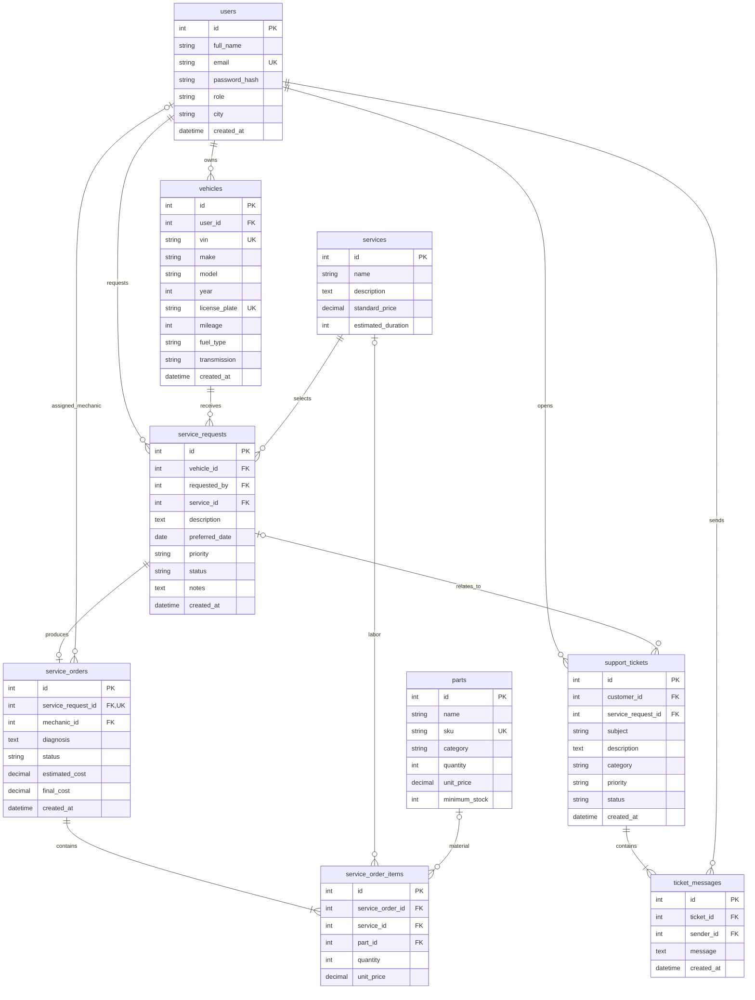

# PitStop OS - entity relationship diagram

Implemented in Milestone 2 in `pitstop_os.sql`. GitHub renders this Mermaid diagram. Minimum child counts and cross-table business rules remain service-layer responsibilities for M3.

## Why these entities exist
- users: customer ownership and employee identity in a single role-aware model.
- vehicles: vehicle details independent of individual visits.
- service_requests: customer intent, preferred date and service progress.
- services: reusable labor catalog and initial pricing.
- service_orders: workshop assessment, assigned mechanic and costs.
- parts: stock catalog with low-stock thresholds.
- service_order_items: historical labor and material quantities/prices for a repair.
- support_tickets: customer support issue with optional service context.
- ticket_messages: chronological conversation with sender attribution.

## Constraints and decisions for Milestone 2
- Primary keys are positive auto-increment IDs; all foreign keys are indexed.
- `email`, `sku`, `license_plate` and non-null `vin` are unique. Empty VIN input becomes NULL in MySQL. VIN is optional; transmission and city extend the initial proposal to support the required UI.
- `service_requests.service_id` replaces free-text service_type with a catalog FK. A request selects one primary service; an order can contain multiple labor/part items.
- A request has zero or one order; enforce UNIQUE(service_request_id). An order can have no mechanic until assignment.
- users.role is admin, mechanic or customer. Service validation must enforce customer ownership and mechanic assignment roles; foreign keys alone do not enforce roles.
- requested_by must own the selected vehicle. A ticket's linked request must belong to its customer.
- Exactly one of service_id and part_id on each order item must be non-null (XOR). Quantity must be positive. Each order has at least one item, enforced transactionally by services.
- Stock, mileage, prices and costs must be nonnegative; duration must be positive. Money uses DECIMAL(10,2), never floating-point storage. Store item prices as historical snapshots.
- final_cost remains NULL until completion. Estimated cost is a quotation; final cost is the sum of order item quantities multiplied by snapshot prices. No tax or discount model is included in M1.
- Restrict deleting referenced customers, vehicles, services or parts. Preserve historical orders and conversations. Plan archiving instead of destructive history deletion.
- Requests: Requested, Approved, Diagnosing, In Progress, Ready for Pickup, Completed, Cancelled. Orders use the corresponding workshop subset. Update both in one transaction later.
- Tickets: Open, In Progress, Waiting for Customer, Resolved, Closed. A ticket begins with one message created in the same transaction.
- M2 sample passwords use bcrypt hashes; the static frontend still has no real authentication. UserDao excludes hashes from ordinary reads.
- M2 implements the schema and DAO layer. Business rules/transaction orchestration and routes follow in M3; actual authorization follows in M4.

## Frontend collection mapping
`users`, `vehicles`, `services`, `parts` retain their names. `requests` -> service_requests; `orders` -> service_orders; `items` -> service_order_items; `tickets` -> support_tickets; `messages` -> ticket_messages. These short frontend collection names are internal; API services will normalize responses.
